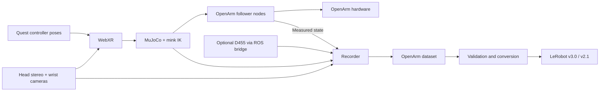

# OpenArm Real

Quest WebXR teleoperation and demonstration recording for an OpenArm 2.0 bimanual robot on NVIDIA Jetson AGX Orin.

面向 **Jetson AGX Orin + OpenArm 2.0 双臂 + Quest** 的真机遥操作与示范数据采集工程。通过 Dora 连接头显、逆运动学、机械臂驱动、多路相机和录制器，再将示范数据转换为 LeRobot 格式。

这是现有部署代码的开源快照，不是已经完成实机验收的产品。发布范围为源码、机器人模型、配置模板、测试及转换工具；录制数据、TLS 证书、私钥、虚拟环境和运行日志不在仓库中。

## Architecture / 架构



Real-robot dataflows feed measured state back into IK and record the commands actually sent by the follower after limits. MuJoCo is used for the robot model and kinematics; these real-robot dataflows do not start a physics viewer.

## Repository layout / 目录

| Path | Purpose |
| --- | --- |
| `run.sh` | Select arm mode, transport and camera variant |
| `install.sh` | Install core, hardware or dataset dependencies |
| `convert.sh` | Validate and convert recorded OpenArm datasets |
| `config/` | IK velocity limits and Quest camera panel configuration |
| `dora-openarm-data-collection/*.yaml` | Dora dataflow and dataset metadata templates |
| `dora-openarm-data-collection/nodes/` | WebXR, IK, robot, camera, UI and recording nodes |
| `openarm_control/` | Forward/inverse kinematics and QP constraints |
| `openarm_mujoco/` | OpenArm robot model and mesh assets |
| `scripts/` | Dataset preflight and LeRobot output verification |
| `docs/DEPLOYMENT.md` | Installation, camera setup and collection workflow |
| `docs/KNOWN_LIMITATIONS.md` | Snapshot limitations and outstanding work |
| `docs/PROVENANCE.md` | Upstream revisions and publication changes |

## Getting started / 开始使用

Target environment: Ubuntu 22.04 / aarch64 on Jetson. The project uses Python 3.12 environments managed by `uv`. Install `uv` before invoking the installer.

```bash
git clone https://github.com/EdgeAI-2000/openarm-real.git
cd openarm-real
bash install.sh core
.venv/bin/python preflight.py
```

`preflight.py` is a local IK benchmark; it does not connect to motors. A fresh clone has no `.venv` or `.venv-dataset`: create them with the installer, rather than copying a machine-specific environment.

For a Quest USB connection and the configured head/wrist cameras:

```bash
bash run.sh check usb-stereo
```

`check` creates no follower/robot-driver node and does not record episodes. It checks the WebXR, camera and IK path. It opens camera devices and configures Quest ADB forwarding, so ensure those devices are available first.

The collection UI listens on `127.0.0.1:8000`; `/monitor` shows camera previews. See the [deployment guide](docs/DEPLOYMENT.md) for SSH forwarding and Wi-Fi TLS setup.

## Modes / 运行模式

| Invocation | Behavior |
| --- | --- |
| `bash run.sh check usb-stereo` | Four-camera WebXR/IK check without motors or recording |
| `bash run.sh right usb-stereo` | Right-arm teleoperation with four cameras |
| `bash run.sh left usb-stereo` | Left-arm teleoperation with four cameras |
| `bash run.sh bimanual usb-stereo` | Bimanual teleoperation and four-camera recording |
| `bash run.sh check usb-stereo d455` | Check with an additional overhead camera |
| `bash run.sh bimanual usb-stereo d455` | Bimanual recording with five cameras |
| `bash run.sh check wifi` / `right wifi` / `left wifi` | Wi-Fi modes; TLS required, camera recording absent |

USB stereo is the default transport when the second argument is omitted. Wi-Fi bimanual mode is available as `bash run.sh bimanual wifi`; it records joints but no images. No hardware motion is implied by cloning or installing the repository.

## Data / 数据

The example task templates describe arranging letter blocks to spell **DIG**. Replace the prompt and operator fields for your own collection task before recording. The four-camera and D455 templates are independent.

```bash
bash install.sh dataset
bash convert.sh \
  dora-openarm-data-collection/real_data/YOUR_DATASET \
  lerobot_data/YOUR_OUTPUT
```

Defaults: LeRobot v3.0, 30 FPS, `qpos`, 1 Hz smoothing cutoff, 80% train split, success-only and valid-only episodes. The output directory must not already exist. Validation may update validity flags in the input dataset; preserve a backup of raw metadata when needed.

The standard bimanual layout is right arm 7 joints + gripper, followed by left arm 7 joints + gripper: **16 action and 16 state values**. Head images are configured at 1280×720 per eye, wrist images at 960×600. The optional overhead stream records JPEGs received through ROS bridge; it is not hardware-synchronized with the local cameras.

## Hardware behavior / 真机行为

Robot modes default to stopped. The UI **Arm Start** command creates and starts the driver and may move the robot to its configured initial pose. Recording buttons and motor controls are separate. Alignment moves toward the hand-controller target before normal following begins.

Follower guards stop on target/feedback timeouts, reject invalid/stale targets, check arm tracking error and bound commands using elapsed time. Bimanual faults propagate to the peer follower. These are software checks; task-level collision avoidance is not implemented. Software Stop and process exit may execute a stop trajectory; they are not a physical emergency stop. Real-robot operation requires onsite supervision, a verified CAN mapping, known zero positions and a physical emergency stop. See [known limitations](docs/KNOWN_LIMITATIONS.md).

## License and attribution

Apache-2.0; see [LICENSE](LICENSE) and [NOTICE](NOTICE). Upstream Enactic OpenArm copyrights and component license files are preserved. This repository is maintained by EdgeAI-2000 and is not an official upstream OpenArm release.

## Software verification

`tests/test_runtime_guards.py` uses fake drivers for fault injection; it never connects to motors. GitHub Actions runs these tests, existing compute/camera unit tests, the local IK benchmark and source-manifest verification. Refresh source hashes with `python scripts/update_manifest.py` after editing files.

Historical frequency metadata can be inspected with `python scripts/measure_dataset_rates.py PATH_TO_RAW_DATASET`. Add `--update` to back up and repair only frequency metadata. Raw images and trajectories are left intact.
