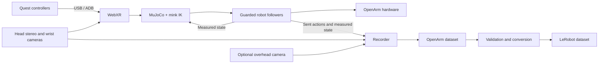

# OpenArm Real

**English** · [简体中文](README.zh-CN.md)

Quest WebXR teleoperation and demonstration recording for **OpenArm 2.0 + NVIDIA Jetson AGX Orin**. A **USB Type-C data cable** connects Quest directly to Jetson; USB stereo is the default transport.

Dora connects controller poses, inverse kinematics, robot followers, cameras and recording. Recorded demonstrations can be validated and converted to LeRobot v3.0 or v2.1. This repository contains software and models; datasets, environments and credentials are kept outside version control.

## Architecture



MuJoCo provides the model and kinematics; the real-robot dataflows do not launch a physics viewer. Recorded actions are the commands actually sent after the follower's limits.

## Project layout

```text
openarm-real/
├── README.md                  # English overview
├── README.zh-CN.md             # Chinese overview
├── LICENSE / NOTICE / MANIFEST.json
├── install.sh / run.sh / convert.sh
├── config/                    # IK limits and headset view settings
├── dataflows/
│   ├── usb/                   # Default direct-USB workflows
│   └── wifi/                  # Optional wireless workflows
├── metadata/                  # Dataset task/equipment templates
├── nodes/                     # Dora node packages
├── packages/
│   ├── openarm_control/       # FK, IK and QP constraints
│   └── openarm_mujoco/        # Robot model and mesh assets
├── requirements/
│   ├── constraints.txt        # Selected dependency pins
│   └── snapshots/             # Historical environment records
├── scripts/                   # Benchmarks and dataset/source utilities
├── tests/                     # Hardware-free integration/guard tests
├── docs/                      # Deployment, limitations and provenance
└── .github/workflows/         # Automated software checks
```

Runtime folders are created as needed and ignored by Git: `.venv/`, `.venv-dataset/`, `data/raw/`, `data/lerobot/`, `runtime/` and `artifacts/`. See [directory and migration guide](docs/PROJECT_LAYOUT.md).

## Install

Robot target: Ubuntu 22.04, aarch64, Jetson AGX Orin. The installer uses private Python 3.12 environments managed by `uv`.

```bash
git clone https://github.com/EdgeAI-2000/openarm-real.git
cd openarm-real
bash install.sh core
.venv/bin/python scripts/preflight.py
```

Install `uv` first, or set `UV_BIN` to its executable. The installer can also reuse `.venv/bin/uv`. The benchmark runs local IK without connecting to motors. Fresh clones must create their own environments.

`core` installs compute, WebXR, cameras, UI and recording. `hardware` adds driver bindings and requires a matching OpenArm CAN installation. `dataset` creates the separate conversion environment and requires system `ffmpeg`. Installation does not configure CAN or enable motors.

## USB Type-C connection

Use a data-capable USB cable. Enable Quest developer mode and USB debugging, then authorize Jetson in the headset. ADB and the head/wrist cameras must be available.

```bash
adb devices
bash run.sh check usb-stereo
```

This checks WebXR, cameras and IK without robot followers or episode recording. It opens cameras and sets up ADB reverse forwarding for port 8443, then opens the headset page after Quest wakes. USB WebXR listens on `127.0.0.1:8443` without TLS.

The collection UI is at `http://127.0.0.1:8000/`; `/monitor` provides camera previews. For access from another computer, replace the account/host below and keep the tunnel open:

```bash
ssh -N -L 127.0.0.1:18000:127.0.0.1:8000 your-user@jetson.local
```

Open `http://127.0.0.1:18000/`. Camera paths can be overridden with `STEREO_CAMERA_DEVICE`, `WRIST_CAMERA_LEFT_DEVICE` and `WRIST_CAMERA_RIGHT_DEVICE`. See the [deployment guide](docs/DEPLOYMENT.md) for calibration and setup.

## Run modes

| Command | Behavior |
| --- | --- |
| `bash run.sh check` | Default USB check; no motors or recording |
| `bash run.sh right usb-stereo` | Right arm and four cameras |
| `bash run.sh left usb-stereo` | Left arm and four cameras |
| `bash run.sh bimanual usb-stereo` | Both arms and four cameras |
| `bash run.sh check usb-stereo d455` | Check with a fifth overhead stream |
| `bash run.sh bimanual usb-stereo d455` | Both arms and five-camera recording |
| `bash run.sh MODE wifi` | Optional TLS/Wi-Fi mode; no camera recording |

The second argument defaults to `usb-stereo`; the third defaults to `standard`. D455 is supported only for USB `check`/`bimanual` and depends on external ROS bridge/image services. Wi-Fi is an optional compatibility path, separate from the direct USB workflow.

## Collect and convert

Set the task and operator in `metadata/bimanual-stereo.yaml`, or `metadata/bimanual-stereo-d455.yaml` for five-camera mode. The example task spells **DIG** with letter blocks. These templates are independent.

Robot modes begin stopped. UI **Arm Start** initializes the driver and may move to the configured initial pose. Align before following. Motor controls and recording controls are separate: A while idle starts recording; A during recording marks success; B during recording marks failure; B while idle exits.

Each run records under `data/raw/`. The standard layout is right seven joints + gripper, then left seven joints + gripper: **16 action and 16 state values**. Head images are configured at 1280×720 per eye and wrist images at 960×600. Actual recorded frame rates must be measured from timestamps.

```bash
bash install.sh dataset
bash convert.sh data/raw/YOUR_DATASET data/lerobot/YOUR_OUTPUT
```

Defaults: LeRobot v3.0, 30 FPS, `qpos`, 1 Hz smoothing cutoff, 80% train split, success-only and valid-only episodes. Output paths must be new. Validation may update input validity metadata; preserve raw backups. Single-arm debugging data is not the standard bimanual training layout.

## Control behavior and limits

Follower guards reject invalid/stale commands, stop on target/feedback timeouts, check arm tracking error and limit position-command changes using elapsed time. IK requires fresh targets and measured feedback for every active side. A bimanual fault requests a peer stop; restarting requires a fresh manual Start.

These are software checks, not physical acceptance results. Driver startup/stop movements are outside the command limiter; blocking driver calls can delay the watchdog. Software Stop is not a physical emergency stop. Onsite verification of CAN mapping, zero positions, camera identity and stopping behavior is required. Task-level collision avoidance is not implemented. See [known limitations](docs/KNOWN_LIMITATIONS.md) and [repair results](docs/REPAIR_RESULTS.md).

## Development

GitHub Actions runs fake-driver fault tests, compute/camera unit tests, the local IK benchmark and source-hash verification. No motor driver is constructed by these tests.

```bash
.venv/bin/python -m pytest -q tests packages/openarm_control/tests \
  nodes/dora-openarm-stereo-camera/tests \
  nodes/dora-openarm-webxr/tests \
  nodes/dora-openarm-dataset-recorder/tests
python scripts/update_manifest.py
python scripts/update_manifest.py --check
```

Historical rates can be inspected with `python scripts/measure_dataset_rates.py data/raw/YOUR_DATASET`. `--update` backs up the metadata before replacing frequency fields; images and trajectories are preserved.

## License

[Apache-2.0](LICENSE), with upstream copyrights and component licenses preserved. See [NOTICE](NOTICE) and [source provenance](docs/PROVENANCE.md). Maintained by EdgeAI-2000; this is not an official upstream OpenArm release.
