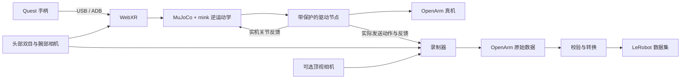

# OpenArm Real

[English](README.md) · **简体中文**

面向 **OpenArm 2.0 双臂 + NVIDIA Jetson AGX Orin** 的 Quest WebXR 遥操作和示范数据采集工程。Quest 通过 **USB Type-C 数据线**直接连接 Jetson，默认采用 USB 双目模式。

工程使用 Dora 串联手柄位姿、逆运动学、机械臂驱动、多路相机和录制器，并将示范数据校验、转换为 LeRobot v3.0 或 v2.1。仓库包含源码和机器人模型；数据集、运行环境及证书不纳入版本控制。

## 工作流程



MuJoCo 提供机器人模型和运动学计算，真机流程不会启动物理仿真窗口。录制的动作是驱动节点经过限幅后实际发送的命令。

## 项目目录

```text
openarm-real/
├── README.md                  # 英文说明
├── README.zh-CN.md             # 中文说明
├── LICENSE / NOTICE / MANIFEST.json
├── install.sh / run.sh / convert.sh
├── config/                    # IK 约束和头显画面设置
├── dataflows/
│   ├── usb/                   # 默认的 USB 直连流程
│   └── wifi/                  # 可选的无线流程
├── metadata/                  # 任务、设备与采集信息模板
├── nodes/                     # Dora 节点包
├── packages/
│   ├── openarm_control/       # 正逆运动学与 QP 约束
│   └── openarm_mujoco/        # 机器人模型与网格资源
├── requirements/
│   ├── constraints.txt        # 关键依赖版本约束
│   └── snapshots/             # 历史环境版本记录
├── scripts/                   # 性能检查、数据和源码工具
├── tests/                     # 不连接硬件的保护与集成测试
├── docs/                      # 部署、已知限制与来源说明
└── .github/workflows/         # 自动检查
```

运行时按需创建 `.venv/`、`.venv-dataset/`、`data/raw/`、`data/lerobot/`、`runtime/` 和 `artifacts/`，这些目录由 Git 忽略。目录职责和旧路径对应关系见[目录与迁移指南](docs/PROJECT_LAYOUT.md)。

## 安装

真机目标环境为 Jetson AGX Orin、Ubuntu 22.04、aarch64。安装器通过 `uv` 创建独立的 Python 3.12 环境。

```bash
git clone https://github.com/EdgeAI-2000/openarm-real.git
cd openarm-real
bash install.sh core
.venv/bin/python scripts/preflight.py
```

先安装 `uv`，或通过 `UV_BIN` 指定其可执行文件；安装器也能复用 `.venv/bin/uv`。`preflight.py` 仅做本机 IK 计算，不连接电机。首次克隆需要创建自己的环境。

`core` 安装计算、WebXR、相机、界面和录制依赖；`hardware` 安装驱动绑定，需要匹配的 OpenArm CAN 库；`dataset` 创建独立转换环境，需要系统已有 `ffmpeg`。安装不会配置 CAN 或使能电机。

## USB Type-C 直连

使用支持数据传输的 USB 线。为 Quest 开启开发者模式和 USB 调试，并在头显内授权 Jetson。确认 ADB、头部双目和两路腕部相机可用。

```bash
adb devices
bash run.sh check usb-stereo
```

检查模式验证 WebXR、相机和 IK，不创建机械臂驱动节点，也不录制 episode。它会打开相机、配置 8443 端口的 ADB reverse，并在头显唤醒后打开 WebXR 页面。USB WebXR 仅监听 `127.0.0.1:8443`，不需要 TLS 证书。

采集界面位于 `http://127.0.0.1:8000/`，相机预览位于 `/monitor`。从另一台电脑访问时，将下面的账号和主机替换为 Jetson 的实际信息，并保持连接：

```bash
ssh -N -L 127.0.0.1:18000:127.0.0.1:8000 your-user@jetson.local
```

电脑访问 `http://127.0.0.1:18000/`。相机路径可通过 `STEREO_CAMERA_DEVICE`、`WRIST_CAMERA_LEFT_DEVICE`、`WRIST_CAMERA_RIGHT_DEVICE` 覆盖。标定和详细配置见[部署指南](docs/DEPLOYMENT.md)。

## 运行模式

| 命令 | 功能 |
| --- | --- |
| `bash run.sh check` | 默认 USB 检查，不连接电机、不录制 |
| `bash run.sh right usb-stereo` | 右臂遥操作，四路相机 |
| `bash run.sh left usb-stereo` | 左臂遥操作，四路相机 |
| `bash run.sh bimanual usb-stereo` | 双臂遥操作，四路相机 |
| `bash run.sh check usb-stereo d455` | 增加第五路顶视画面的检查 |
| `bash run.sh bimanual usb-stereo d455` | 双臂遥操作，五路相机录制 |
| `bash run.sh MODE wifi` | 可选 Wi-Fi 模式，需要 TLS，不录制相机 |

第二个参数默认 `usb-stereo`，第三个参数默认 `standard`。D455 只支持 USB 的 `check` 和 `bimanual`，依赖外部图像服务和 ROS bridge。Wi-Fi 作为可选兼容入口保留，USB 直连流程不依赖它。

## 采集与转换

四路版本修改 `metadata/bimanual-stereo.yaml`，五路版本修改 `metadata/bimanual-stereo-d455.yaml`。填写实际任务和操作者；示例任务是用字母积木拼出 **DIG**。两份配置相互独立。

真机模式初始为停止状态。点击采集界面的 **Arm Start** 后才创建并启动驱动，此时可能移动到预设初始姿态。先完成对齐，再进行跟随。电机控制与录制控制分开：空闲时 A 开始录制，录制时 A 标记成功、B 标记失败，空闲时 B 退出。

每次启动的数据写入 `data/raw/`。标准双臂布局为右臂七关节加夹爪，再接左臂七关节加夹爪，共 **16 维动作和 16 维状态**。头部相机每眼配置为 1280×720，腕部相机为 960×600。实际帧率应按录制时间戳测量。

```bash
bash install.sh dataset
bash convert.sh data/raw/YOUR_DATASET data/lerobot/YOUR_OUTPUT
```

默认导出 LeRobot v3.0，采用 30 FPS、`qpos`、1 Hz 平滑截止频率和 80% 训练集划分，只选成功且有效的 episode。输出路径必须尚不存在。校验可能更新输入数据的有效性标记，建议保留原始备份。单臂调试数据不属于标准双臂训练布局。

## 控制行为与限制

驱动节点会拒绝非有限值和过期指令，在目标或反馈超时时停止，检查关节跟踪偏差，并按实际经过时间限制位置命令变化。IK 要求每个启用侧都有新鲜的手柄目标和实机反馈。双臂中任一侧故障会请求另一侧停止；恢复需要新的手动 Start。

这些保护已经过软件测试，但还不能代替实机验收。驱动启动和停止轨迹不受上述位置命令限幅器覆盖，阻塞的驱动调用也可能延迟超时处理。软件 Stop 不是硬件急停。CAN 对应关系、零位、相机左右身份和实际停止效果仍需现场确认；当前没有任务级避障。详见[已知限制](docs/KNOWN_LIMITATIONS.md)和[修复验证记录](docs/REPAIR_RESULTS.md)。

## 开发与检查

GitHub Actions 检查假驱动故障场景、计算与相机单元测试、IK 性能及源码文件清单。测试不创建真实电机驱动。

```bash
.venv/bin/python -m pytest -q tests packages/openarm_control/tests \
  nodes/dora-openarm-stereo-camera/tests \
  nodes/dora-openarm-webxr/tests \
  nodes/dora-openarm-dataset-recorder/tests
python scripts/update_manifest.py
python scripts/update_manifest.py --check
```

查看旧数据的实际频率：`python scripts/measure_dataset_rates.py data/raw/YOUR_DATASET`。增加 `--update` 会先备份元数据，再更新频率字段，不修改图像和轨迹。

## 许可证

采用 [Apache-2.0](LICENSE)，保留上游版权和组件许可证。详见 [NOTICE](NOTICE)和[源码来源说明](docs/PROVENANCE.md)。本项目由 EdgeAI-2000 维护，不是 OpenArm 官方发布版本。
